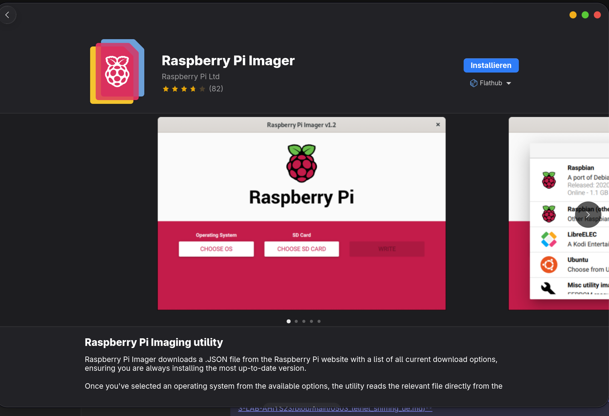
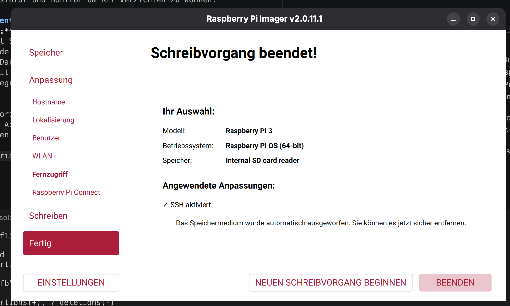
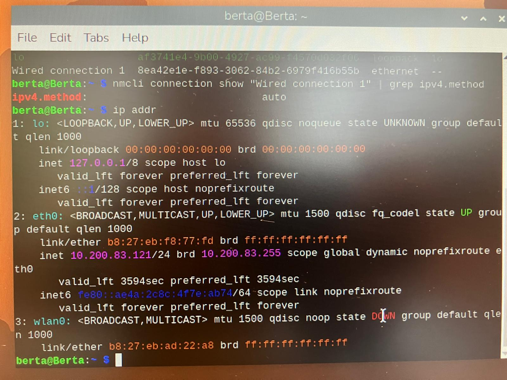
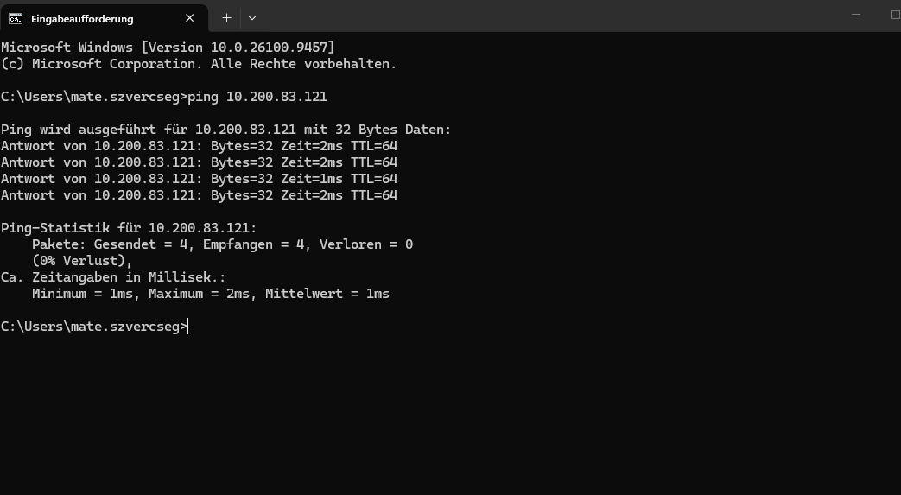
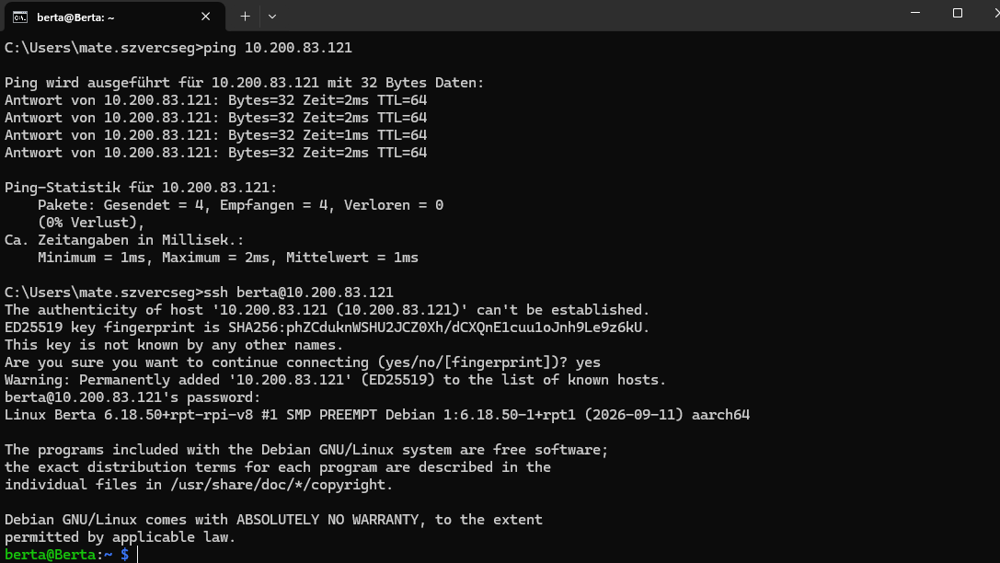

# Arbeitsbericht
 
**Fach: ITP2-I**
 
**Name: Mate Szvercseg und Alexander Schauer**
 
**Klasse: 4AHITS**
 
**Datum: 02.10.2026**
 
**Aufgabenstellung: [01_rpi](https://github.com/HTL-Braunau-probst/ITPI-4/blob/main/0101_rpi.md)**

## Vorbereitung
 - Rasperberrypie Image Herunterladen
 


##  Start

**Aufgabenstellung:**
- Konfiguriere ein passendes Tastaturlayout
- Konfiguriere so, dass der RPi die IP Adresse per DHCP bezieht.
- Setze einen eindeutigen Hostnamen.
- Sicherheitsmaßnahme: Es soll kein Login mit Default Login Daten möglich sein.
- Auf den RPi soll per SSH zugegriffen werden können. Konfiguriere weiters Login per SSH keys.


**Was haben wir gemacht?**  

im Imager
- Raspberry Pi 3 Board auswählen 
- RPI OS 64 Bit auswählen
- Speichermedium: Internal SD-Card medium
- Hostname auswählen, unser Hostname: Berta
- **Lokalisierung:** 
  - Hauptstadt: Vienna 
  - Zeitzone: Europe/Vienna 
  - Tastatur Layout: AT
- Benutzername: berta
- Passwort: berta123
- WLAN: Überspringen -> Wir verwenden LAN
- SSH: Aktivieren -> Passwort zu authentifizierung verwenden
- Rasberry Pi Connect: nicht aktivieren
- Image: schreiben



Lan Kabel einstecken und in Terminal ```ip addr``` eingeben

Falsches Lan Kabel verwendet, deswegen kein internet verbindung (20 min Fehlersuche, ohne KI) 



## Remote Desktop

**Aufgabenstellung:**
- Teste die Erreichbarkeit des RPi im Schulnetz per ping und ssh.
- Arbeite nun weiter mit einer Kali VM auf einem Schulrechner. Teste auch hier die Verbindung zum RPi.
- Konfiguriere Remote Desktop: Es soll von der Kali VM aus die GUI des RPi dargestellt werden können. Das Ziel dabei ist in weiterer Folge auf die eigenen Tastatur und Monitor am RPi verzichten zu können.

**Was haben wir gemacht:**
- Rasperry Pi gepingt

- Rasperry Pi per ssh 

- Rpi von Kali (VmWare) pingen
.png)
- auf Kali ssh Verbindung zu Rpi erstellen ```ssh berta@10.200.83.121```
-  dann auf berta remote Steuerung und Konfiguration erlauben durch ```sudo raspi config ```
.jpg)
- Download VNC Server auf Kali
.jpg)
.jpg)
- alles auf oke
  .jpg)
- bei VNC server den IP des RPis eingeben
  .jpg)
- als nächste Berta und als Passwort: berta123
.jpg)

.jpg)
- Runter zu -> about raspi-config
.jpg)
.jpg)
- enterdrucken dann geht der Remote Steuerung.
  


## Remote Development
**Aufgabenstellung:**  
Konfiguriere Visual Studio Code (sollte bei Kali schon installiert sein – zum Test code in der shell eingeben) zum remote development auf dem Raspberry Pi. Dabei verwendet man VS Code unter Kali als Editor, ist aber per SSH mit dem RPi verbunden und editiert die Dateien dort, das in VS Code integrierte Terminal ist ebenfalls mit dem RPi verbunden.

Folge z.B. dem Tutorial unter Visual Studio Code: Remote development over SSH. Hinweis: Azure ist nicht notwendig weil wir einen RPi als remote machine haben.

Bringe den im Totorial beschriebenen Node JS express Server zu laufen.

- Auf Kali Vs Code starten
- Remote ssh extension auf das Vs code installieren
  .png)
- als nächste Vs code neustarten 
- links unten auf das symbol clicken
-   .png)
- dann "connect to host" auswählen
.png) 
- ```configure host```
  .png)
- enter clicken
- Daten des Rpi im configuration einschreiben
.png)
- config speicher und zu machen
- wieder links unten auf das Symbol clicken
- connect to Host -> den IP des RPis auswählen -> enter
- Passwort von berta eingeben
 .png)
- Juhu es funktioniert
.png) 


  
