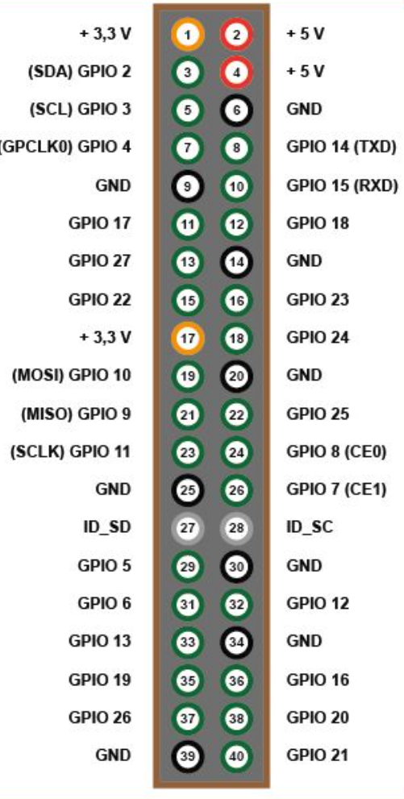

# Arbeitsbericht
 
**Fach: ITP2-I**
 
**Name: Mate Szvercseg und Alexander Schauer**
 
**Klasse: 4AHITS**
 
**Datum: 16.10.2026**
 
**Aufgabenstellung: [02_rpi](https://github.com/HTL-Braunau-probst/ITPI-4/blob/main/0102_rpi.md)**

## Display

**Aufgabenstellung:**  
Nimm das angeschlossene Display in Betrieb. Dieses hat die Bezeichnung **0,96 Zoll OLED SSD1306 Display I2C 128 x 64 Pixel**.

Recherchire wie die Pins vom Display mit dem Raspberry angeschlossen werden müssen. Hinweis: Alle Pins sind mit dem Raspberry zu verbinden. [Raspberry Doku](https://www.elektronik-kompendium.de/sites/raspberry-pi/1907101.htm)

Anschlüsse des Displays:

**BEACHTE dass die Pins auf der Rückseite herausgeführt sind**

Im Raspberry muss das I2C Interface erst aktiviert werden.

Schreibe ein Python Programm um etwas auf dem Display darzustellen.

- Library: adafruit/Adafruit_CircuitPython_SSD1306 Hinweis: es ist unter Umständen nur das Installieren als "virtual environment" möglich. Auf alle Fälle dann wenn die Fehlermeldung error: externally-managed-environment auftritt.  

Hinweise zur Library:

- Die Klasse SSD1306_I2C ist von (framebuf.FrameBuffer) abgeleitet. Daher können die Methoden von FrameBuffer verwendet werden (z.B. fill, pixel, …). D.h. die Beschreibung dieser Befehle findet man in der FrameBuffer Dokumentation.

- Download des zur Textausgabe notwendigen Fonts:

```$ wget https://github.com/adafruit/Adafruit_CircuitPython_framebuf/raw/main/examples/font5x8.bin```

Gib am Display den Hostnamen, die IP Adresse und die Netzwerkmaske (in / Notation) aus:

Hinweis: Keine Werte im Programm vorgeben, d.h. Hostnamen, die IP Adresse und die Netzwerkmaske im Programm ermitteln.

Hinweis 1: Verwende das Python Modul ```netifaces```.

Hinweis 2: Das Modul ```ipaddress``` ermöglicht aus der Netzwerkmaske die / (Präfix) Notation abzuleiten:

```python
import ipaddress
iface=ipaddress.IPv4Interface(('192.168.100.1', '255.255.255.0'))
print(str(iface))
```

---

**Bericht:**

Display anstecken:



unsere Verkablung:

- GND ist auf Pin 6
- VCC ist auf Pin 4
- SCL ist auf Pin 5
- SDA ist auf Pin 3

I2C Interface aktivieren:

- in terminal ```sudo raspi-config``` eingeben
- zu Interface Options
- zu I2C
- bei enable auf yes

## Weitere Aufgabenstellung

**Aufgabenstellung:**

Das Python Script soll automatisch beim Starten des RPi aufgerufen werden.

Hinweise:

Verwende ```rc.local```

Lege im Homverzeichnis des Raspberry Pi User ein shell-script an, dass das python script startet:
```
cd /home/pi/dev
./display_text.py > log.txt 2>&1 &
```
Erklärung:

- Der User heißt pi, das Python Skript muss executable sein und sich im Unterverzeichnis dev befinden.
- Durch > log.txt werden alle entstehenden Ausgaben in die Datei log.txt geschrieben, das ermöglicht eine Fehleranalyse.
- 2>&1 Leitet stderr auf stdout um, sonst würden Fehlerausgaben nicht in die log.txt Datei geschrieben.
- Das & am Ende startet das Python Skript im Hintergrund und setzt die shell script Ausführung fort.
- Das rc.local Skript wird als root ausgeführt, für root können manche Python Module nicht geladen werden. Lösung: mit der sudo Option -u kann die Ausführung als beliebiger User gestartet werden:

```sudo -u pi /home/pi/dev/runrc.sh```

---

**Bericht:**